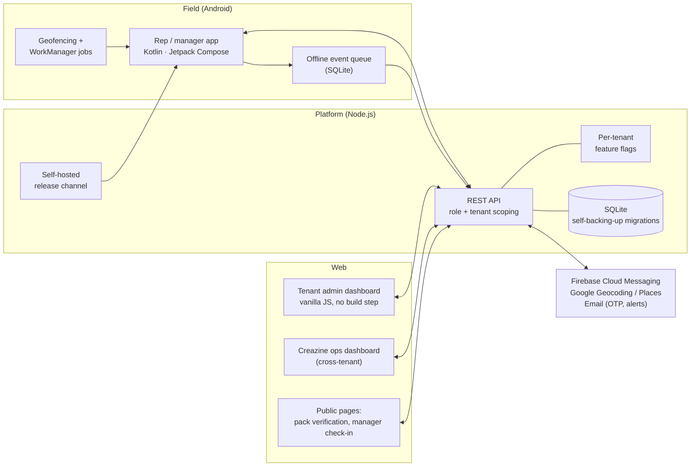

# MR FieldTrack: architecture case study

**A multi-tenant field-force platform for pharmaceutical sales teams: a native Android app, a
Node.js API and a web admin dashboard. It has been in daily production use by a real field team since 2026.**

> This repository documents the design. The source code is private: the product is
> commercial and runs a client's live operation. Demos and a code walkthrough are available on request:
> [creazine.office@gmail.com](mailto:creazine.office@gmail.com) · [product page](https://www.creazinetech.com/android-app-development-by-creazine-technology/)

---

## The problem

Pharma companies run on medical representatives (MRs), who visit doctors every day to present products.
The traditional record of that work is a **self-reported call sheet**: the rep writes down who they
saw and what was discussed. Managers can't tell:

- whether the visit actually happened, or happened at the right clinic
- whether the rep followed the planned route
- whether the notes say anything real, or are copy-pasted filler
- whether the area manager who says they "worked with" a rep was actually there

## What the platform does

| For field reps (Android) | For managers and admins (web dashboard) |
|---|---|
| Visits detected automatically by **GPS geofencing** around each clinic | Route plans assigned per rep per day, pinned to a specific clinic |
| Structured call report: products, prescriber status, follow-up, sample request | Live overview: map, attendance, compliance, unsubmitted-report backlog |
| Report **locks on submit**, with only a short correction window | Missed-visit, call-frequency and per-rep **monthly performance** reports |
| Today's route, missed visits and punctuality on one screen | Doctor database with duplicate detection, merge, trash and CSV import/export |
| Onboard a new doctor or chemist from the field, with GPS captured automatically | Review queue for rep-suggested doctors |
| Leave, expenses, tour plans, joint field work | Approvals, team hierarchy, attendance rules, branding |
| Works for area and regional heads too, with a live **team view** | **Joint field work verification:** proof the manager was physically present |

Plus a **consumer-facing pack authentication** module: QR codes on product packs, a public
verification page, scan logging by region and clone detection.

## Architecture at a glance

Full write-up: **[docs/architecture.md](docs/architecture.md)**

## Deep dives

| Document | What it covers |
|---|---|
| [Architecture](docs/architecture.md) | Components, multi-tenancy, feature flags, roles, deployment and release pipeline |
| [Visit verification](docs/visit-verification.md) | Geofence visit detection, clinic pinning, nightly geofence refresh, manual fallback, offline queue, joint-field-work proof-of-presence |
| [Reporting and analytics](docs/reporting-and-analytics.md) | How a review of real call notes led to a redesigned call report, prescriber funnel, filler-note detection and doctor-movement tracking |
| [Data model](docs/data-model.md) | Entity overview: tenants, people, doctors and clinics, visits, plans, authentication |
| [Security and operations](docs/security-and-operations.md) | Session revocation, screen protection, signed QR serials, safe migrations, release management, version tracking |

## Tech stack

| Layer | Technology |
|---|---|
| Android | Kotlin, Jetpack Compose (Material 3), Google Play Services Location (geofencing), WorkManager, Retrofit / OkHttp, Firebase Cloud Messaging and Crashlytics. Min SDK 26, target SDK 35. |
| Backend | Node.js, Express, SQLite (`node:sqlite`), HMAC-signed sessions with server-side revocation, Nodemailer |
| Admin dashboard | Vanilla JavaScript served by the API itself: no framework, no build step |
| External services | Google Maps, Geocoding and Places APIs (each metered call behind its own per-tenant flag), FCM, transactional email |
| Quality | Node's built-in test runner, ~60 test suites covering the API, permissions and every feature-flag gate |

## Numbers

- **Real users:** live with a working pharma field team since 2026, with releases shipping continuously
- **Data scale:** 500+ doctors and ~900 clinic locations under geofence, and hundreds of locked call reports a month
- **Modules:** 15+ independently switchable per tenant
- **Five roles:** platform admin, tenant admin, regional head, area head and rep, each with its own team-scoped visibility

## Built by

**Sabyasachi Bhattacharya**, founder of [Creazine Technology](https://creazinetech.com). I designed,
built and run the product end to end: product scope, Android app, backend, dashboard, releases and
support for the client's team.

[GitHub profile](https://github.com/creazineoffice) · [Other products](https://www.creazinetech.com/creazine-saas-products/)

---

© 2026 Creazine Technology. Documentation only: no source code is published or licensed here.
