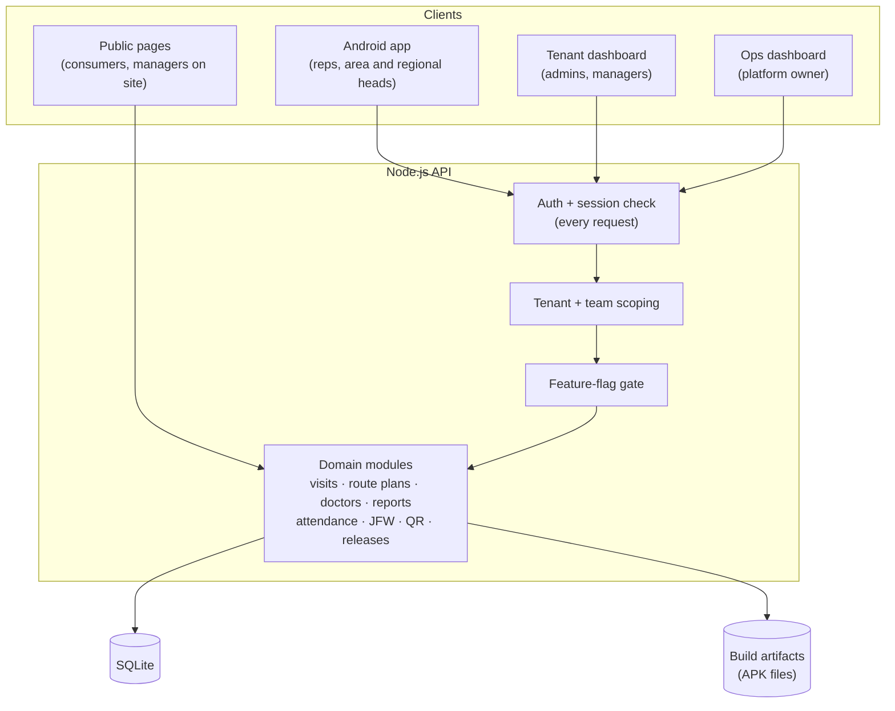
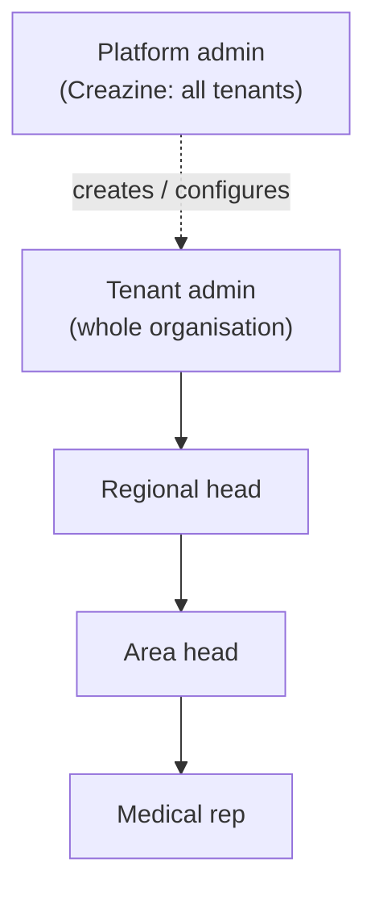
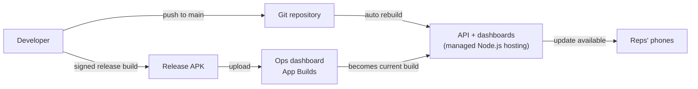

# Architecture

## Components

**Android app (field users).** One native app serves reps and their managers, and its features
switch on the role of the person signed in. It uses a bottom navigation shell (Home, Routes, Reports,
More), with a central action for onboarding a new doctor.

**API server.** A single Node.js service. Every request is authenticated, and every query is scoped to
the caller's organisation and, for managers, to the people under them in the reporting tree.

**Tenant admin dashboard.** Served as static files by the API itself, written in plain JavaScript with
no framework and no build step. The deployable is one service and nothing else, and the dashboard
runs comfortably on low-end office machines.

**Creazine ops dashboard.** A separate internal app for the platform owner. It creates tenants, switches
modules on and off per tenant, publishes Android builds, and shows which app version every rep in
every tenant is running, without logging into any tenant's own dashboard.

**Public pages.** These pages are deliberately small, server-rendered and need no sign-in: consumer pack
verification, and the one-tap check-in page that managers use during joint visits.

## Multi-tenancy

It was built as a product from day one, not as a one-off client app, so a second pharma company can be
onboarded without forking the code.

- **Data isolation.** Every tenant-owned row carries its organisation, and the API applies that scope
  on every query.
- **Branding per tenant.** The tenant's logo and brand colour appear on the login screen and the dashboard.
  The dashboard picks them up from the subdomain.
- **Feature flags per tenant.** Modules are sold and switched on individually by the platform owner,
  and a tenant can't enable a module it hasn't bought. The gate is enforced on the server: a module that
  is off returns "forbidden" from the API, and its navigation disappears from both clients.

Switchable modules include targets, tour plans, joint field work, expenses, chemist directory,
missed-visit reports, manual visit logging, pack authentication, QR anomaly detection, and the
metered Google integrations.

### Metered APIs have their own flags

Address auto-fill (Geocoding) and "is this the place?" suggestions (Places) each cost money per call.
Each one sits behind its **own** flag, separate from the module that uses it, so a tenant can have the
chemist directory without paying for place suggestions. When a flag is off, the code path makes **no
network call at all** and the UI shows no empty field. Enabling one is treated as a billing decision,
not a technical one.

## Roles and visibility

- **Reps** use only the Android app.
- **Area and regional heads** use both. In the field they log visits and file reports like reps.
  On the team view and dashboard they see only the reps under them, at any depth of the tree.
- **Admins** see the whole organisation. The **platform admin** sees across tenants, but only
  through the ops dashboard.
- **Deactivating a user takes effect on their very next request,** not at their next login. The
  session is revoked on the server, and the app signs out and clears its local cache.

## Sign-in

- **One-time codes by email.** Sign-in uses one-time codes sent by email, which costs nothing per
  login, unlike SMS. The email contains a verified **Android App Link** that opens straight into the
  app. A custom URL scheme was tried first and dropped, because Gmail strips non-standard links.
- **Typo protection.** First-time email capture asks the person to confirm the address, so a mistyped
  email can't lock someone out of their first login.

## Deployment

- **Web deploys automatically on every push to main.** Every schema change is a migration that only
  adds, runs itself at startup and **takes a snapshot of the database before it touches anything**.
  No column or row is dropped without its data being copied first.
- **Android releases are deliberate.** A signed build is checked on a test phone, then uploaded
  through the ops dashboard, where it immediately becomes the "current" build. Distribution is
  self-hosted rather than the Play Store, because it's an internal workforce app.
- **Rollback is one click:** promote an earlier build back to current.
- **Updates install from inside the app.** The app compares its version with the server's current
  build, downloads the update and hands it to Android's installer. The rep confirms the install,
  because Android never allows silent self-updates for sideloaded apps.

## Design decisions and trade-offs

| Decision | Why | Trade-off |
|---|---|---|
| **SQLite instead of a database server** | One service to run, the database is a single file that's easy to back up, and plenty for the write volume of one field team | Moving to Postgres is planned once several large tenants share one instance |
| **No-build dashboard** | Zero front-end tooling and instant deploys | More hand-written DOM code than a framework would need |
| **Attendance computed live instead of by a nightly job** | The original nightly job design failed silently in production, and records stayed "pending" forever. Computing from route plans and locked reports is always correct. | Slightly more work per request |
| **Self-hosted APK distribution** | Release control, instant rollback, per-user version tracking and no store review delay | Updates need one tap from the rep |
| **Matching is "warn, don't block"** | A rep in the field is never stopped from working by a fuzzy check | Admins review flags instead |
