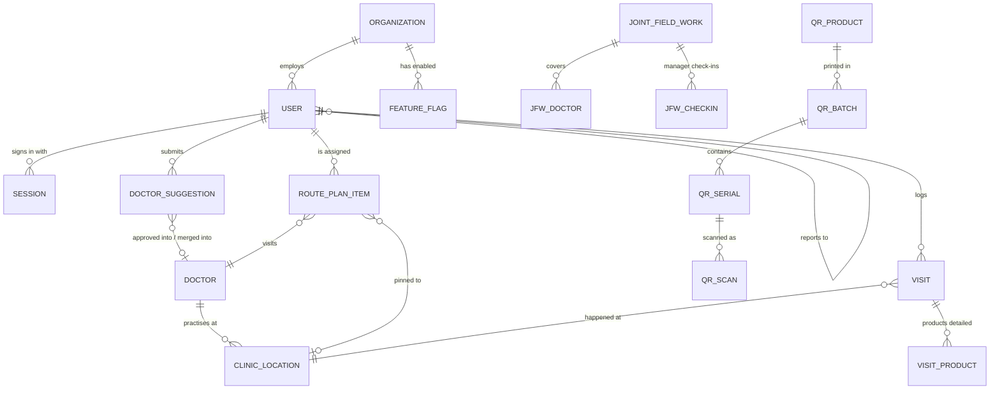

# Data model

About 40 tables in total, grouped below by domain. These are entity-level only, without column detail.

## Domains

| Domain | Entities | Notes |
|---|---|---|
| Tenancy and access | organisations, feature flags, users, one-time codes, sessions | Sessions are stored on the server, so they can be revoked instantly |
| Doctors | doctors, clinic locations, suggestions, duplicate dismissals, field options | A doctor's identity is kept separate from their clinics, because one doctor can have several geofenced clinics |
| Field activity | visits, products detailed, samples, attendance, attendance settings | Attendance status is computed from activity, not stored by a nightly job |
| Planning | route plan items, route plan requests, tour plans, targets | A plan item can be pinned to one clinic |
| Teamwork | joint field work, its doctors, manager check-ins | Check-ins hold the browser GPS fix and the device identity |
| HR | leave applications, expenses | Approval workflows |
| Directory | chemists, chemist duplicate dismissals | One row per name and location, by design |
| Pack authentication | products, batches, serials, scans, settings, flags | Serials are signed, and scans store only the region, never the raw IP address |
| Platform | Android builds | The release channel |

## Conventions

- **Attribution everywhere.** Every row that answers "who did this and when" stores created-by and
  created-at, or submitted-by and reviewed-by. Features such as crediting the right rep for a doctor
  they onboarded need no extra plumbing.
- **Original values kept.** When doctor names were split into first, middle and last, the original
  free-text name was kept as a permanent backup.
- **Soft deletes for anything a person might regret.** Doctors, chemists and requests go to a trash
  view that can be restored.
- **Migrations only add.** New columns allow empty values, old rows keep their meaning, and every
  migration that changes data is preceded by a full database snapshot.
