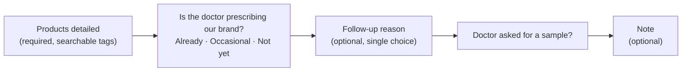

# Reporting and analytics

## Starting from the data, not the form

A month after launch, I reviewed every call note the field team had submitted that month,
several hundred of them. What the data showed:

- **Notes were 100% filled in, but most of them were boilerplate.** The same sentence was reused for many
  doctors, or the text was junk, because the form required a note.
- **The one real signal reps did write down was whether the doctor was prescribing the brand.**
- The structured fields on the old form, such as key messages and objections, were not giving
  managers anything they used.

So the redesign followed the evidence rather than adding more fields.

## The redesigned call report

- **The rep sees the last read.** Before filling in the form, the rep sees the doctor's previous
  prescriber status, so each call builds on the last one.
- **Old builds keep working.** The server accepts both old-style and new-style reports, with the
  validation rules for each, so reps on an older app build kept working during the rollout. The backend
  went live before the app.

## What managers get

**Monthly performance scorecard** (one row per rep):

| Measure | Meaning |
|---|---|
| Calls | Calls where the doctor was present |
| Doctors covered | Unique doctors visited that month |
| Active days | Days the rep logged field activity |
| Doctors onboarded | New doctors approved, out of those suggested |
| Route adherence | Planned visits actually made, at the pinned clinic |
| Report quality | **Good / Review / Filler**, computed from how varied the notes are, the share of junk notes, and one-sentence-for-many-doctors patterns |

- **Prescriber funnel:** of a rep's calls with a status, how many doctors are already prescribing,
  occasional, not yet, or not interested.
- **Doctor movement:** per doctor, whether the latest status moved up or down compared with the previous
  read by anyone. **A move up only counts as confirmed** when a second call agrees with it, or a
  verified joint visit backs it up, so a single optimistic report can't inflate the numbers.
- **Drill-down:** clicking a rep shows each doctor's calls in date order, with status, follow-up,
  sample request and products.

**Operational views:**

- **Unsubmitted-report backlog (all time).** This was added after it turned out that some reps had
  weeks of visits with no report, which no existing view showed.
- **Missed visits.** Planned doctors who never got a visit, by rep and by most-missed doctor.
- **Call frequency.** Days since the last visit against a target per doctor, or the organisation's
  default target.
- **Team "last active".** Answers "is this rep actually signed into the app?"
- Every list exports to CSV.

## Principles

1. **Measure what the field already does.** The scorecard needed no new input from reps. It reads data
   that visits, plans and suggestions already produce.
2. **Don't claim what the data can't prove.** Prescriptions and sales aren't captured, so the
   scorecard doesn't pretend to measure them.
3. **Make gaming harder rather than adding rules.** Confirmed movement, verified joint visits and
   filler detection all reward honest reports without adding steps to the form.
