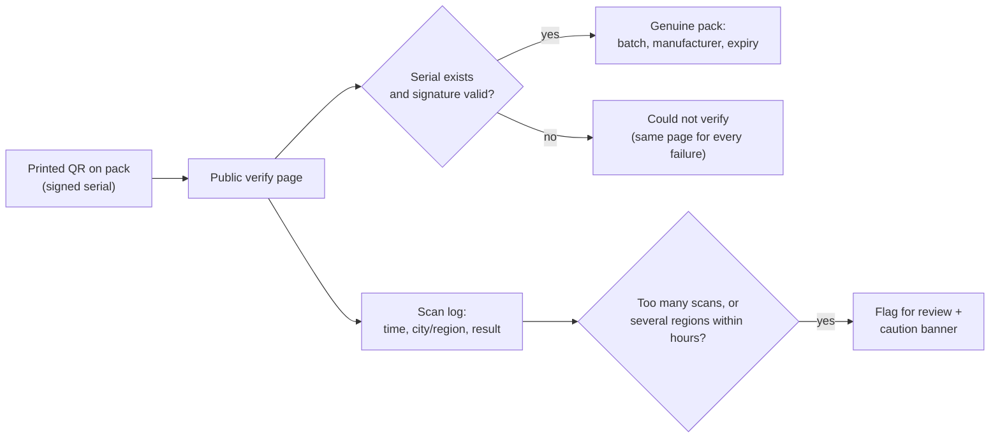

# Security and operations

## Access and sessions

- **Sessions are stored and revocable on the server,** not stateless tokens that stay valid until
  they expire. They are checked on **every** request.
- **Offboarding is immediate.** A deactivated user is signed out on their next request, and the app
  clears its local cache at the same moment.
- **Idle sessions expire,** and the "last active" time on the team page comes from real server contact.
- **Team-scoped visibility is enforced on the server.** A manager calling any reporting endpoint gets
  only their own reporting tree, whatever the client asks for.

## Protecting field data on the device

- **Screenshots and screen recording are blocked app-wide.** This was widened from a few screens to
  the whole app, after a review found doctor names on a screen that wasn't covered.
- **A watermark with the rep's name** sits on the doctor list and report screens. Blocking screenshots
  can't stop someone photographing the screen with a second phone, so the watermark makes any leaked
  photo traceable to the person who took it.
- **A consent and privacy screen** is shown during onboarding, before location permission is requested.

## Consumer pack authentication

- **Signed serials.** Each serial is signed with a server-side secret, so serials can't be made up
  or guessed.
- **One failure page for every reason.** An unknown serial, a bad signature, an inactive product and a
  disabled tenant all show the same "could not verify" result, so the page gives nothing away.
- **Rate limits and privacy.** The page is rate-limited per IP address. Scans record the city and
  region only, never the raw IP address or any identity.
- **Clone detection** flags a serial scanned too many times, or from distant regions within a short
  window. Both thresholds are set per tenant.
- **The verify domain can't reach anything else.** On the dedicated verification hostname, only the
  verify page and the health check can be reached, so pointing a subdomain at the service can't expose
  the dashboard or the API.
- **Its limits are stated:** this raises the cost of cloning a printed code. It can't prove which
  physical pack is the original.

## Releases and fleet visibility

- **Fleet-wide version visibility.** Every app start reports its version to the server, and the ops
  dashboard shows **who is on which version, in every tenant**, in one place.
- **Version numbers are mandatory.** Every release bumps the version code. The in-app update prompt
  depends on it, and two early releases that reused a number taught that lesson.
- **Signing keys are managed deliberately.** The release keystore is backed up outside the repository.
  The App Link configuration lists the active certificate fingerprints, so sign-in links keep opening
  the app through a key transition.

## Operational habits

- **Every release is logged:** what changed, which target (web or Android), and how it was checked live.
- **Tests run before every deploy.** They cover permissions, tenant isolation and each feature-flag gate,
  checking that it's blocked when off and works when switched on.
- **Built-but-not-released is a real state.** For example, offline sync is built and merged, but
  is kept out of release builds until it has been fully verified on real devices. Merging code is not
  the same as releasing it.
- **Metered services are billing decisions.** Paid Google API features stay off for a tenant until the
  client agrees to the cost.
