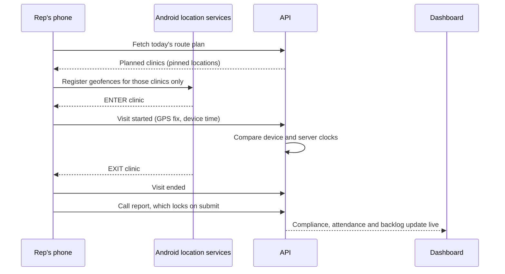
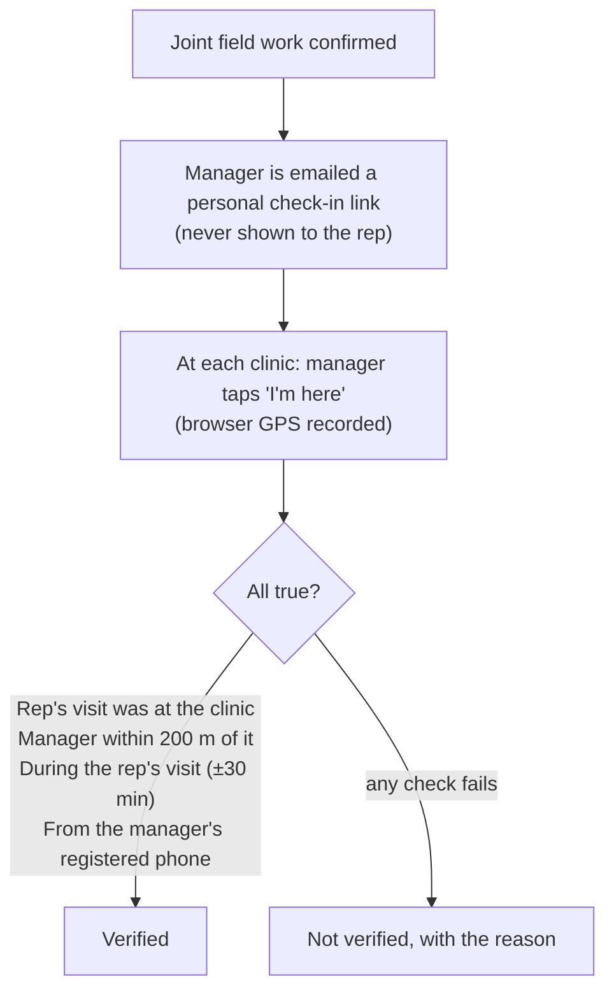

# Visit verification

The platform's core promise: **a visit on the report is a visit that happened, at the clinic it was
planned for.**

## Geofence visit detection

Each registered clinic has a geofence, about 100 m by default. Each morning the app registers
geofences for **the clinics on that day's route plan**, and Android reports when the phone enters and
leaves them, even while the app is in the background.

### Details that matter in production

- **Clinic pinning.** Many doctors practise at several clinics. When a route plan sends a rep to a doctor
  with more than one clinic, the admin pins *which* clinic. Only a visit at that exact location
  satisfies the plan. A visit at the doctor's other clinic shows as unplanned.
- **Nightly geofence refresh.** An early build registered geofences that never expired, so every
  clinic from earlier days stayed watched until the phone rebooted, and old clinics produced false
  "unplanned visits". Now the app clears all geofences before registering a day's plan, and a
  background job swaps in the next day's clinics shortly after midnight. That job deliberately doesn't
  trigger "already inside", so nobody gets a visit logged at midnight.
- **Clock tampering.** Every event carries both the device time and the server time. A gap of more
  than a few minutes is flagged for admin review.
- **Manual fallback.** When GPS or the geofence fails, the rep can start a visit manually, but must give
  a reason, and the distance from the clinic's registered location is recorded for review. Manual
  logging is itself a per-tenant switch. Turning it off makes the route plan mandatory.
- **Location must be on.** A visit can never be logged with the device's location toggle off. The app
  checks this explicitly and shows a banner, instead of failing on a missing GPS fix.

### Offline queue (built, held back for final verification)

Field areas often have no signal. With offline sync, a geofence event or manual start that fails
*only* because there's no connection is stored in an on-device queue, then replayed through the normal
API once the phone is online. Nothing changes on the backend. The rep is told plainly that the location is saved and that
they still need to open the app to write the report.

## Joint field work: proof of presence

Area and regional heads are expected to spend field days *with* their reps. Self-reported "joint work"
has the same honesty problem as call sheets. The platform verifies it per doctor, and the manager
doesn't even need the app:

- **The first phone to check in becomes the manager's registered device.** If the link is forwarded
  (say, to the rep on WhatsApp) and used on another phone, the check-in is flagged.
- **No hints for gaming it.** The check-in page never shows a distance or a verdict.
- **Results show where people already look:** "3 of 4 verified" on the joint-work page, and against
  each doctor in the rep's performance history.
- **Where its limits are stated:** it can't stop a manager handing over their own phone, or a GPS
  spoofing app. It raises the cost of faking a joint visit. It doesn't claim to make faking impossible.

## Data-quality guards

- **Duplicate doctors.** A new doctor suggestion is flagged when the name matches *and* it's within
  500 m of an existing doctor. Name matching understands initials, so "R. K. Pal" matches "Ram Krishna
  Pal". This is a warning, never a block.
- **Duplicate clinics.** "Same clinic" means within 150 m **and** a similar clinic name, so a
  differently named clinic next door is never merged by mistake.
- **Resubmission.** A suggestion that arrives twice through a double tap or a retry returns the existing
  pending item instead of creating a duplicate.
- **Place suggestions.** When a rep adds a clinic or chemist, the app can suggest the establishment's
  name from Google Places, but only for a tight 50 m match against healthcare-type places, and never
  automatically.
